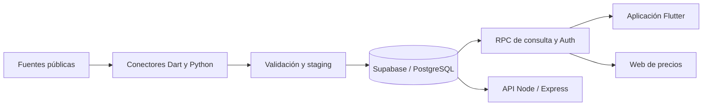

<p align="center">
  
</p>

<h1 align="center">Tiago Market</h1>

<p align="center">Comparación de precios para comprar con más información.</p>
<p align="center">
  
  
  
  
</p>

Tiago Market reúne precios observados de comercios de México para buscar
productos, comparar opciones y organizar una lista de compras. El proyecto
combina una aplicación Flutter, una web de consulta y un pipeline de ingesta
que conserva fuente, fecha y evidencia de cada observación.

## Funciones implementadas

- **Búsqueda y comparación:** agrupación de productos, presentaciones, imágenes
  y precios por comercio, con filtros y ordenamiento.
- **Contexto de cada precio:** separación entre catálogo online y precios
  asociados a una sucursal; fecha, fuente y frescura visibles.
- **Experiencia móvil:** acceso invitado, Google mediante Supabase Auth,
  favoritos, historial de búsqueda y lista de compras.
- **Carrito por cuenta:** caché local separada por usuario y sincronización con
  Supabase, con políticas de acceso por propietario.
- **Preparación de compra:** comparación de canastas y borrador de envío a
  domicilio con preferencias de pago.
- **Ingesta verificable:** conectores independientes, validación previa,
  deduplicación y publicación de observaciones mediante jobs externos.

## Decisiones de ingeniería

La búsqueda consulta observaciones guardadas: no dispara scraping. La ingesta
se ejecuta fuera de los clientes y valida identidad, presentación,
disponibilidad y evidencia antes de publicar. Un precio online no se convierte
en precio local sin una sucursal verificable.

Las credenciales privilegiadas quedan en el servidor o en GitHub Actions.
Los clientes usan configuración pública y RPC de Supabase; el carrito de cada
cuenta se protege con RLS. La [arquitectura](docs/architecture.md) explica los
componentes y sus límites.



## Explorar el código

| Componente                                 | Tecnologías                       | Código                                                |
| ------------------------------------------ | --------------------------------- | ----------------------------------------------------- |
| Aplicación móvil y cliente multiplataforma | Flutter, Dart                     | [`apps/flutter_app`](apps/flutter_app)                |
| Web de consulta online                     | TypeScript, Vite, CSS             | [`apps/price_web`](apps/price_web)                    |
| API y jobs del backend                     | Node.js, Express, TypeScript, Zod | [`src`](src)                                          |
| Captura y validación de fuentes            | Dart, Python                      | [`tools/ingestion`](apps/flutter_app/tools/ingestion) |
| Migraciones y contratos SQL                | PostgreSQL, Supabase              | [`supabase`](apps/flutter_app/supabase)               |

## Ejecutar localmente

Requisitos: Node.js 20 o superior, Flutter compatible con el proyecto
(validado con 3.41.7), Python 3 y un proyecto propio de Supabase para consultar
datos y usar autenticación. Los tests usan fixtures y servicios simulados.

**Backend**

```bash
npm ci
cp .env.example .env
# Completar .env con la configuración del servidor.
npm run api
```

**Aplicación Flutter**

```bash
cd apps/flutter_app
flutter pub get
cp config/dart_defines.example.json dart_defines.local.json
# Completar únicamente con configuración pública del cliente.
flutter run -d chrome --dart-define-from-file=dart_defines.local.json
```

La app necesita una base configurada y RPC disponibles para mostrar precios;
el repositorio no incluye acceso a datos de producción. La
[guía de desarrollo](docs/development.md) detalla la web, las pruebas y las
limitaciones del historial de migraciones.

## Verificación

```bash
# Backend
npm run lint
npm run build
npm test

# Flutter, desde apps/flutter_app
flutter analyze
flutter test
python3 -m unittest discover -s tools/ingestion/python -p 'test_*.py'
```

GitHub Actions incluye controles de calidad y detección de secretos. Los jobs
de ingesta y de release Android tienen configuración independiente.

## Alcance actual

Es un prototipo en desarrollo. Los precios son referencias observadas y pueden
cambiar; disponer de un conector no garantiza cobertura ni datos vigentes.
La disponibilidad online no acredita stock físico por sucursal.

El checkout prepara un borrador: todavía no crea órdenes, procesa pagos ni
contrata envíos. El modo negocios está en preparación. La reconstrucción de
una base vacía requiere reconciliar las migraciones históricas.

## Documentación

- [Arquitectura y decisiones técnicas](docs/architecture.md)
- [Instalación y pruebas](docs/development.md)
- [Contrato de la API Node](docs/api-v1.md)
- [Cliente Flutter y release Android](apps/flutter_app/README.md)
- [Captura y publicación de precios](apps/flutter_app/tools/ingestion/README.md)
- [Seguridad](SECURITY.md) y [criterio de publicación](docs/github-publication.md)

Las marcas y logos de los comercios pertenecen a sus titulares. Se incluyen
para identificar fuentes y vendedores; no implican una asociación comercial.
